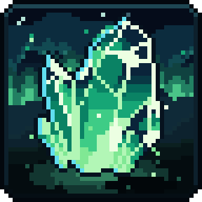

  

<h1 align="center">Groidberbium</h1>

<i>A faster chunk rendering fork of Emberbium for Forge 1.20.1.</i>

---

## ✦ About

A fork of [Emberbium](https://github.com/shuttheirprayer/Emberbium) → [Embeddium](https://github.com/embeddedt/embeddium) → [Sodium](https://github.com/CaffeineMC/sodium), with bug fixes and much faster rendering.

The mod id is still `embeddium`, so addons like Oculus and Embeddium Extra keep working.

## ✦ Performance

Average FPS vs. Emberbium 0.3.32, MacBook Air M2, vanilla world, 1% lows in brackets:

| Test | Emberbium | Groidberbium | |
| --- | --- | --- | --- |
| 12 chunks | 228 (94) | 230 (99) | +1% |
| 24 chunks | 135 (53) | 155 (74) | **+14%** |
| 32 chunks | 99 (47) | 120 (103) | +21% |
| 64 chunks | 47 (31) | 73 (54) | **+55%** |

## ✦ Credits

All credit to the original authors. This couldn't exist without their work.
